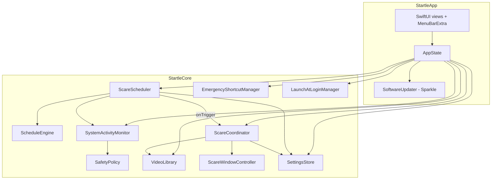

# Architecture

Startle ships as two Swift Package Manager library targets plus the Xcode app:

- **StartleCore** (`Sources/StartleCore/`) — all scheduling, safety, library,
  and presentation logic as `@MainActor @Observable` classes. It is testable
  without the app bundle via `swift test`.
- **StartleApp** (`Sources/StartleApp/`) — SwiftUI views, the `MenuBarExtra`,
  `AppState` (dependency wiring), and the Sparkle `SoftwareUpdater`.
- **Startle** (`Startle.xcodeproj`) — the sandboxed, hardened-runtime app
  target. The Xcode build is required to exercise App Sandbox bookmark and
  launch-at-login behavior; SPM alone cannot.

## Module map

`AppState` constructs the graph once at launch and connects the callbacks:

- `scheduler.onTrigger` → `coordinator.trigger()`
- `activity.onSuspend` → `coordinator.dismiss()` (a sleeping or locked Mac
  closes any visible scare)
- `activity.onWake` → `scheduler.reschedule()` (overdue triggers are discarded)
- `library.onEnabledVideosChanged` → disable scares when no enabled video
  remains
- `EmergencyShortcutManager` action → `AppState.emergencyDisable()`

## Responsibility by type

| Type | Owns | Notes |
| --- | --- | --- |
| `SettingsStore` | All persisted state | `PersistedSettings` Codable in UserDefaults; bounded 50-event activity history; `recordScare()` updates daily counters |
| `ScheduleEngine` | Pure scheduling policy | Stateless and deterministic; injected RNG/calendar make it fully testable. See [scheduling.md](scheduling.md) |
| `ScareScheduler` | The one live timer | Exactly one cancellable `Task` at a time; reschedules after every firing, preference change, and wake |
| `SystemActivityMonitor` | Live system signals | Polls every 15 s (battery, volume, displays, camera/mic, full-screen window, Apple capture apps, idle) plus `NSWorkspace` sleep/session observers |
| `SafetyPolicy` | Block decision | Pure function: `SystemActivitySnapshot` + `SafetySettings` → `SafetyBlockReason?` |
| `ScareCoordinator` | One scare at a time | Re-checks exclusions and safety immediately before presentation; resolves bookmarks; records outcomes |
| `ScareWindowController` | On-screen playback | Borderless high-level AppKit windows, AVPlayer, countdown, Escape capture, stall + presentation watchdogs, cursor/app restore |
| `VideoLibrary` | Video registry | Security-scoped bookmarks, metadata in `Application Support/Startle/VideoLibrary.json`, recovery copy, missing-file tracking. See [video-library.md](video-library.md) |
| `EmergencyShortcutManager` | Cmd–Opt–Shift–Esc hot key | Public Carbon `RegisterEventHotKey`; scheduled scares fail closed until registration succeeds |
| `LaunchAtLoginManager` | `SMAppService.mainApp` | Honors "Never run at login" and the `requiresApproval` state |

## The path of a scheduled scare

1. `ScareScheduler` sleeps until `nextTriggerDate`, then calls
   `currentStatus`. Anything other than `.ready` records a `skipped` activity
   event and reschedules.
2. `ScheduleEngine.shouldTrigger` re-validates eligibility (active window,
   daily limit, cooldown, pause) and rolls the dice in `.randomChance` mode.
3. `ScareCoordinator.trigger()` runs the final gates in order: safety snapshot
   → frontmost-app exclusion → pick a video → resolve its bookmark →
   exclusion check again → `ScareWindowController.present` with a `preflight`
   closure that re-checks safety one last time right before playback starts.
4. `ScareWindowController` builds its windows, optionally counts down, plays
   the trim range, and returns `.completed`, `.dismissed`, or `.skipped`.
5. The coordinator records the activity event; a completed non-test scare also
   updates `lastPlayedAt`, `lastScareDate`, and the daily counter.

Every gate is evaluated at firing time, not when the timer was created, so a
stale timer can never bypass a cooldown, pause, or safety condition that
appeared after it was scheduled.

## State

- `PersistedSettings` (UserDefaults via `SettingsStore`): enabled flag,
  onboarding flag, pause deadline, schedule/safety/appearance settings, total
  and daily scare counters, `lastScareDate`, last 50 activity events.
- `VideoLibrary.json` (Application Support): video metadata and bookmark data.
- Everything else (`SystemActivityMonitor` flags, `isPresenting`, hot-key
  registration) is runtime-only and recomputed each launch.

All public types are `Sendable` and the managers are `@MainActor`, so state
changes serialize on the main actor; `ScheduleEngine` and `SafetyPolicy` stay
pure structs so tests drive them with explicit inputs.
